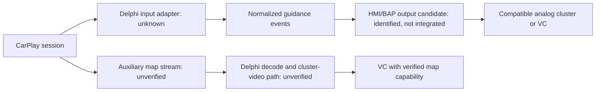

# Proposed architecture

This is a proposed bridge, not an implemented integration. Static research has identified existing ASLNavBAPAPI/HMI output candidates; the input adapter and runtime suitability remain unverified. Reusing the OEM navigation path alongside CarPlay may require compatible NavIgnore or equivalent ownership handling; see [scope and credits](navignore.md). Standalone patch coexistence with RGI/video remains unverified.

The event model should preserve missing/unknown values. It must account for session start/end, active guidance, maneuver type, distance and units, road name, ETA when supplied, stale data and disconnection. Never infer a maneuver from unrelated video or media metadata.

Capabilities are independent: `guidance` and `mapVideo`, each `unknown`, `unsupported` or `supported`, with evidence and firmware/cluster versions. Analog/digital appearance does not determine capabilities. The output transport for guidance must be established per platform rather than assumed to be MOST.

A simulator may use clearly labeled synthetic events once the model is defined. It cannot validate Delphi APIs, transport compatibility, timing on real hardware or installability. No live adapter should silently fall back to invented data.
