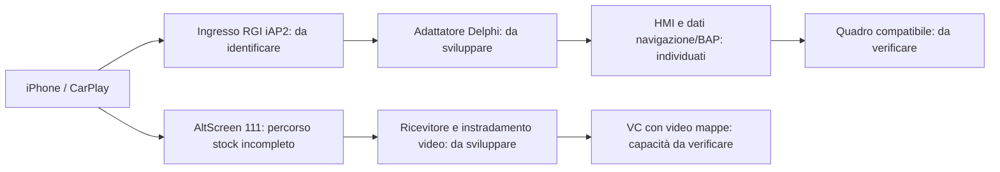

# Delphi CarPlay Cluster Bridge — risultati dell'analisi offline

30 ottobre 2026 · Target principale: MST2_EU_VW_P0879D / STD2Nav_EU_VW.

**Risultato:** è stato individuato un percorso concreto di uscita per le indicazioni nel codice HMI/BAP. Non è ancora stato individuato e verificato un ingresso CarPlay RGI funzionante. Per la mappa indipendente emerge un ostacolo specifico nella libreria AirPlay originale. Non esiste ancora un bridge Delphi operativo.

## 1. Ambito effettivamente esaminato

- Inventario EXTBIN_APPS originale, librerie e programmi rilevanti per CarPlay, iAP2, cluster e MOST.
- Decompressione LZO delle immagini IFS contenenti il codice Java e il runtime Delphi, con controllo dei limiti dei file. L'ultimo blocco LZO è stato limitato alla dimensione dichiarata dell'immagine dopo verifica che il surplus fosse composto da zeri.
- Estrazione locale di MIBHMI.jxe e delphi.jxe, senza eseguirli. Conversione con jxe2jar per l'analisi statica: rispettivamente **19.403 e 5.332 classi**, nessuna classe saltata segnalata. Questi numeri indicano conversione, non analisi semantica completa di ogni classe.
- Esame mirato di interfacce, riferimenti e bytecode nelle aree CarPlay, navigazione/BAP e relativi adattatori.
- Parsing delle tabelle simboli ELF e disassemblaggio ARM di funzioni selezionate della sessione AirPlay e del ricevitore video.
- Confronto per SHA-256 dei componenti rilevanti con l'EXTBIN_APPS P0891D fornito.

Non sono stati eseguiti firmware, applicazioni QNX o classi della radio. Non sono state svolte prove su telefono, radio o bus del veicolo, né caricati file online. I file proprietari estratti restano nell'area di lavoro locale e non sono inclusi nei risultati da condividere.

## 2. Indicazioni: trovato un candidato concreto per l'uscita

L'interfaccia `de/vw/mib/asl/api/navbap/ASLNavBAPAPI` contiene metodi per aggiornare distanza alla prossima manovra, distanza alla destinazione, tempi/ETA, strada di svolta e corsie.

Non è soltanto un nome presente nel firmware: nel bytecode di `HsmTargetBap.dsiNavigationUpdateDistanceToNextManeuver` compare una chiamata a `ASLNavBAPFactory.getNavBAPApi`, seguita da `ASLNavBAPAPI.updateBapDistanceToNextManeuver`. L'implementazione `ASLNavBAPAPIImpl` aggiorna i collector e le liste HMI. `NavigationASLDataAdapter` legge i dati per i consumatori BAP.

Per le manovre, `HsmTargetBap.updateManeuverDescriptor` legge gli elementi del descrittore e aggiorna liste HMI. La struttura osservata contiene `mainElement`, `direction`, `zLevelGuidance` e `sideStreets`. La relativa semantica e la traduzione dagli eventi Apple vanno ancora ricostruite: non basta copiare numeri tra protocolli.

Sono presenti implementazioni `navsd` nelle famiglie Java `mqbab2` e `mqbpq`, comprese funzioni di descrizione manovra e distanza. La presenza di entrambe non identifica automaticamente quella attiva sul veicolo né certifica compatibilità con tutti i quadri analogici.

**Conclusione:** per le indicazioni è ragionevole studiare un adattatore che alimenti il percorso HMI/BAP esistente, prima di progettare un emettitore CAN/MOST indipendente. È un candidato di architettura supportato da evidenze statiche, non una dimostrazione di iniezione riuscita o di funzionamento sul quadro.

## 3. Ingresso CarPlay: manca ancora il collegamento decisivo

Le interfacce originali `DSICarplay` e `DSICarplayListener` hanno rispettivamente 13 e 15 metodi dichiarati. Coprono gestione modalità/risorse, UI, dispositivo, chiamate, audio e metadati multimediali. Non espongono callback espliciti di manovra, distanza o ETA nelle interfacce esaminate.

Le firme di questi metodi, recuperate dal JXE convertito, coincidono con quelle del `dsiifc.jar` originale. È un controllo incrociato utile sulla conversione di queste due interfacce, non una verifica completa del convertitore.

Nel driver iAP2 e nella configurazione esaminata compaiono famiglie di identificazione, media, localizzazione, comunicazioni, EAP, veicolo e destinazione; non sono stati identificati gestori espliciti della guida passo-passo Apple. Le funzioni di destinazione non vanno confuse con un flusso continuo di manovre. L'assenza di nomi riconoscibili non prova l'assenza di codice equivalente.

**Conclusione:** una patch soltanto Java non ha ancora una sorgente RGI dimostrata da leggere. Il prossimo nodo è la negoziazione e ricezione iAP2: stabilire se e dove la sessione Delphi può ricevere gli eventi reali e come trasferirli al livello HMI.

## 4. Mappe: ostacolo specifico nella libreria AirPlay

In `libAirPlay.so`, la funzione `AirPlayReceiverSessionSetup` contiene un dispatch sui tipi di stream che gestisce 100, 101 e 110. Le comparazioni sono visibili agli indirizzi virtuali ELF `0x16e70`, `0x16e7c` e `0x16e84`. Per valori diversi il flusso raggiunge il ramo a `0x1781c`, associato alla segnalazione di stream non supportato e alla prosecuzione del ciclo. Il tipo 111 non viene gestito da quel dispatch.

I progetti pubblici MHI2Q descrivono il tipo 111 come stream CarPlay AltScreen per il quadro. Questo riferimento aiuta a interpretare il limite Delphi, ma non rende applicabili le loro patch o i loro offset.

`libScreenStream.so` contiene un percorso di decodifica H.264 e chiamate a QNX Screen. `ClusterServices` contiene riferimenti a `GfxStreamSink`, `ConnectionMaster`, guida e creazione di un thread video MOST. Nessuna di queste presenze dimostra che un secondo stream CarPlay sia già collegabile al video del quadro.

**Conclusione:** per una mappa CarPlay indipendente servono almeno negoziazione dello schermo aggiuntivo, ricezione del relativo stream, gestione del ciclo di vita e collegamento all'uscita cluster. Modificare soltanto l'elenco dei tipi accettati non implementerebbe queste funzioni. Resta distinta l'eventuale duplicazione dello schermo principale, che non equivale a una mappa indipendente.

## 5. Confronto con P0891D

| Componente | Identico byte per byte al P0879D? |
| --- | --- |
| libAirPlay.so | Sì |
| libAirPlaySupport.so | Sì |
| ipod-drvr-iap2.so | Sì |
| cfg/iap2.cfg | Sì |
| jar/dsiifc.jar | Sì |
| CarPlay / CarPlayServices | No |
| ClusterServices / Most | No |
| libScreenStream.so | No |
| vwjxe.ifs / jdsi.jar | No |

Il campione P0891D non introduce una libreria AirPlay o un driver iAP2 diversi. Quindi il dispatch video individuato nella stessa libreria è presente anche lì. Le differenze nei programmi circostanti restano da esaminare: non segue che i due firmware abbiano comportamento identico in ogni aspetto. Nessun aggiornamento sulla radio è proposto.

## 6. NavIgnore: individuata l'area di arbitraggio

In `carplay/common/NavigationHandler.updateGuidanceActive`, il bytecode fa riferimento a `DSICarplay.requestModeChange` e all'aggiornamento di `setHmiRouteGuidanceActive`. È un punto reale in cui la guida nativa interagisce con le modalità CarPlay, distinto dal trasporto dei dati di manovra.

Questo conferma la necessità di studiare l'arbitraggio, ma non dimostra che una determinata NavIgnore sia obbligatoria o compatibile con il futuro bridge. Il confronto con le classi della patch effettivamente installata non è stato effettuato, perché quella patch non è tra i campioni analizzati. Non va sostituita né rimossa sulla base di questa analisi.

## 7. Percorso di sviluppo consigliato dalle evidenze

Il prossimo traguardo tecnico è provare offline una catena di dati reali o strutture documentate dall'ingresso iAP2 a un modello guida, poi verificare un adattatore verso i punti HMI individuati. Finché l'ingresso reale non è noto, un generatore di frecce sul PC sarebbe soltanto una simulazione.

Prima di considerare prove hardware serviranno anche la versione esatta della NavIgnore già presente, il modello/software del quadro e un ambito di prova separatamente concordato. L'autorizzazione attuale resta limitata al PC.

## 8. Verifiche e limiti

- I due JAR di analisi risultanti dalla conversione superano il controllo CRC ZIP; il convertitore non segnala classi saltate. Non è stato eseguito un verificatore JVM completo né provata la ricompilazione.
- I confini delle istruzioni dei metodi selezionati sono stati letti dal bytecode convertito; non è stata dimostrata l'esecuzione di ogni ramo a runtime.
- Le osservazioni native comprendono parsing ELF, simboli, stringhe e disassemblaggio mirato, non un audit semantico completo di tutti gli eseguibili.
- SHA-256 dell'EXTBIN_APPS P0879D ricontrollato a fine lavoro: `4241058e0d69dfdfaf1b0d7569b5cd42cf8db9c57037d3d6da6e3fbf91d6346c`, uguale all'inventario iniziale.
- Nessuna validazione offline qui riportata prova firme, installabilità, sicurezza del flash o compatibilità hardware.

Il file `evidenze_carplay_delphi.json` riassume componenti, firme dei metodi, collegamenti statici selezionati e confronto versioni, senza includere firmware, classi stock o percorsi personali.

## Riferimenti consultati

- [luka-dev/jxe2jar](https://github.com/luka-dev/jxe2jar): convertitore utilizzato soltanto nell'area locale per l'analisi statica; non incluso nel nostro codice MIT.
- [QNX: OS image / IFS](https://www.qnx.com/developers/docs/6.5.0SP1/com.qnx.doc.ide.userguide/topic/builder_OS_IFS_File.html): contesto sul contenitore IFS.
- [lclevy/dumpifs](https://github.com/lclevy/dumpifs): riferimento tecnico consultato per la struttura dei blocchi IFS/LZO; non eseguito né redistribuito.
- [MHI2Q AltScreen e video](https://github.com/luka-dev/mib2q-carplay-rgi/blob/main/docs/altscreen-and-video/README.md): associazione tra stream 111 e schermo cluster su un'altra piattaforma.
- [mib2q-carplay](https://github.com/kamgurgul/mib2q-carplay): confronto architetturale per RGI e video; nessuna compatibilità Delphi dedotta.
