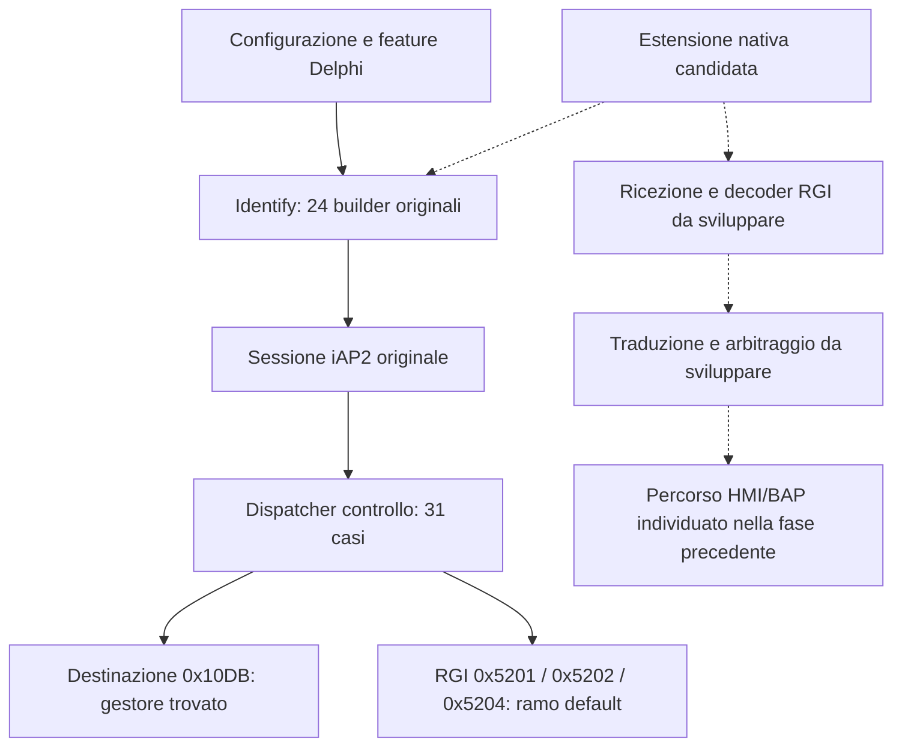

# Delphi P0879D — ricostruzione statica del percorso iAP2

30 ottobre 2026. Analisi dei componenti originali di STD2Nav_EU_VW. Nessun codice della radio eseguito e nessuna operazione su radio, telefono o bus del veicolo.

## Conclusione della fase

**Nel percorso originale ricostruito non c'è una catena RGI pronta da collegare soltanto al quadro.** Esistono identificazione iAP2, trasporto, gestione destinazioni e invio grezzo; mancano però, nel percorso esaminato, gestori dedicati dei messaggi di manovra e un builder dedicato per dichiarare la funzione RGI all'iPhone. L'uscita HMI/BAP individuata nella fase precedente rimane un candidato concreto, ma non riceve automaticamente dati di navigazione CarPlay.

La strada di sviluppo più fondata è un'estensione nativa specifica Delphi per negoziazione, ricezione/decodifica e passaggio all'HMI. È un'architettura candidata, non una patch già realizzata né una prova di fattibilità completa sul veicolo.

## 1. Come nasce l'identificazione dell'accessorio

Nel driver `ipod-drvr-iap2.so`, `ident_info_request` scorre una tabella di **24 builder** e invia `IdentificationInformation`, ID `0x1D01`. I builder coprono identità, versioni, liste dei messaggi, alimentazione, EAP, lingue, trasporti, HID, veicolo e localizzazione.

La tabella non contiene un builder dedicato al componente di route guidance `0x001E` descritto dai progetti pubblici MHI2Q. Il risultato è circoscritto alla tabella e al percorso originali ricostruiti; non è una cattura dei byte effettivamente negoziati con un iPhone.

Ho trovato un'estensibilità utile: `ident_info_sendmsgs` e `ident_info_recvmsgs` leggono anche le chiavi `sendmsgs` e `recvmsgs` della sezione `ident`, convertendo identificativi numerici e aggiungendoli alle liste dichiarate. Il codice ha un controllo di capacità per la lista aggiuntiva. Il file `iap2.cfg` originale fornito non contiene questa sezione.

**Limite:** aggiungere un ID alle liste significa dichiararlo, non implementarne la semantica, non creare un gestore ricevente e non aggiungere automaticamente il componente RGI all'identificazione. Non sono stati modificati file di configurazione.

## 2. Cosa gestisce DestinationInformation

Il percorso trovato usa:

| ID | Ruolo osservato |
| --- | --- |
| `0x10DA` | StartDestinationInformation |
| `0x10DB` | DestinationInformation |
| `0x10DC` | StopDestinationInformation |
| `0x10DD` | DestinationInformationStatus |

`destination_startinfo` invia `0x10DA`; il dispatcher richiama `destination_info_recv` per `0x10DB`. I descrittori dei dati comprendono identificativo, nome, coordinate centrali, indirizzo, punto d'ingresso, soglia delle coordinate e locale.

Questa struttura descrive una destinazione. Non è stata trovata qui la sequenza continua di manovra, distanza alla svolta e corsie richiesta dal progetto. Non si deve confondere l'importazione di una destinazione con la navigazione Apple completa.

L'avvio di questa funzione dipende dal bit `0x20000`; `init_features` tratta la sezione `destination` e la chiave `enable`. Il `iap2.cfg` originale esaminato non contiene tale sezione. Altre configurazioni/override runtime non sono stati osservati sul dispositivo.

## 3. Dove finiscono i messaggi RGI nel dispatcher originale

Nel ramo di controllo di `link_handle_payload` è presente un albero di confronti sull'ID del messaggio. Ho ricostruito in Python soltanto le operazioni intere e i salti di questo albero: non è stato eseguito né emulato l'intero firmware ARM.

La ricostruzione ha valutato tutti i **65.536 ID a 16 bit**, individuando **31 casi espliciti**. I casi noti di identificazione, destinazione e metadati sono stati controllati come riferimenti positivi; un ID sconosciuto come riferimento negativo.

I messaggi di ingresso RGI documentati dai progetti di riferimento prendono tutti il ramo di default:

| ID | Significato nella documentazione di riferimento | Esito nel ramo Delphi ricostruito |
| --- | --- | --- |
| `0x5201` | Aggiornamento della guida | Nessun gestore dedicato |
| `0x5202` | Aggiornamento della manovra | Nessun gestore dedicato |
| `0x5204` | Informazioni corsie | Nessun gestore dedicato |

Il ramo di default non inoltra questi dati a una funzione RGI/HMI; termina la gestione della copia del payload. Questo non dimostra che l'iPhone li trasmetta nella configurazione originale né esclude un diverso percorso runtime non ancora individuato. Dimostra il comportamento dell'albero ricostruito se questi ID lo raggiungono.

`0x5200` e `0x5203` sono invece richieste accessorio → telefono di avvio/arresto aggiornamenti nel progetto di riferimento: non devono essere scambiati per callback in ingresso. Anche per questi ID non sono stati trovati gestori specializzati nel dispatcher esaminato, ma ciò non costituisce da solo un problema per il loro invio.

## 4. Esiste già un candidato per l'invio di messaggi grezzi

La libreria `libiap2client.so` esporta `iap2_raw_msg_send`. Il disassemblaggio mostra che prepara una richiesta IPC QNX con comando `0x3000`. Nel driver, `iap2_msg` gestisce quel comando e richiama `link_send_raw_message`.

Questo collega staticamente API client e trasporto del driver: non è soltanto un simbolo suggestivo. Potrebbe consentire a un futuro modulo di usare il trasporto esistente, senza implementare da zero l'intero collegamento iAP2.

**Non dimostra** accessibilità con i permessi disponibili, accettazione della richiesta dal telefono, corretto ciclo di vita o disponibilità di un canale di ricezione RGI. Non è stata invocata l'API. Non sono state modificate autenticazione o protezioni.

## 5. Catena ricostruita e parti da implementare

Il prossimo modulo non dovrebbe limitarsi a una sostituzione Java. Occorre progettare e verificare:

1. Dichiarazione coerente della funzione RGI e degli ID supportati.
2. Avvio/arresto della sottoscrizione durante il corretto ciclo di vita della sessione.
3. Punto di ricezione dei dati e decoder con limiti, campi facoltativi e gestione dei messaggi incompleti.
4. Traduzione verso le strutture HMI/BAP, senza inventare manovre per valori sconosciuti.
5. Arbitraggio con guida OEM/NavIgnore, fine percorso e disconnessione.

La mappa video resta un filone distinto: questi risultati non rimuovono il limite dello stream 111 documentato in precedenza.

## 6. Esito e verifiche

- Ricostruiti i builder Identify, la gestione destinazioni, il dispatch controllo e il collegamento dell'invio grezzo.
- Hash dei componenti driver/client estratti ricontrollati rispetto all'inventario del firmware originale: corrispondono.
- Valutazione completa del solo albero di dispatch a 16 bit, con casi positivi e negativi; tracce incluse nelle evidenze.
- Annotazioni di stringhe e chiamate usate come supporto, con verifica mirata del disassemblaggio. Non costituiscono una decompilazione completa o un'esecuzione di tutti i rami del driver.
- Nessuna prova con un iPhone, nessuna cattura di sessione reale, nessuna prova su radio e nessuna garanzia di compatibilità o installabilità.
- Nessuna patch del driver o della radio generata. Le conclusioni riguardano questo campione originale e i percorsi esplicitamente descritti.

Risultati strutturati: [evidenze_iap2_delphi.json](evidenze_iap2_delphi.json).

## Fonti di confronto

Gli ID RGI e il componente `0x001E` sono confrontati con la [documentazione del progetto MHI2Q](https://github.com/luka-dev/mib2q-carplay-rgi/blob/main/docs/deploy/install.md). La documentazione descrive una piattaforma diversa: non prova che le sue modifiche siano trasferibili a Delphi. Le conclusioni sul dispatcher e sulle API Delphi derivano invece dai file originali forniti.
